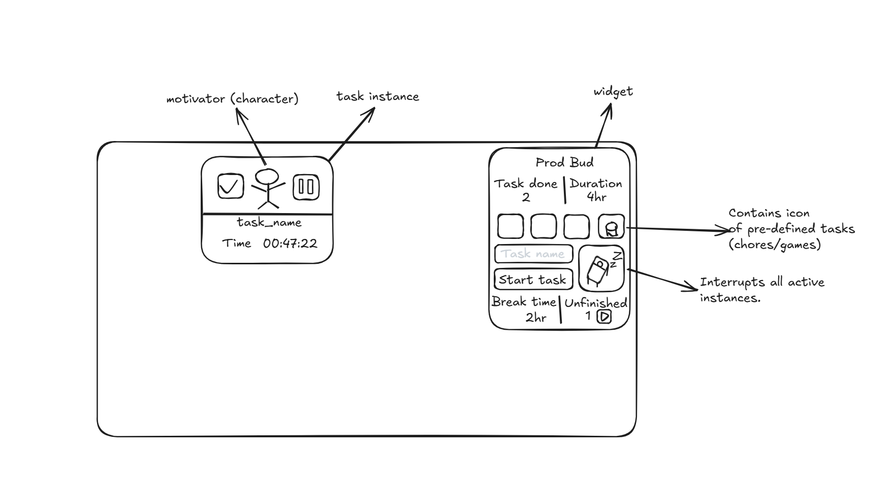

# ProdBud

A lightweight desktop productivity overlay: an always-on-top **widget** plus floating **task cards** with
live timers and a little motivator character. Every task and break is logged as Markdown into your
**Obsidian** vault (no plugin needed; the notes are Dataview-friendly).



Built with Electron and targeted at Windows. The full spec is in [prodbud_plan.md](prodbud_plan.md).

## Features

- **Widget** (docked bottom-right, draggable by its title): Tasks done, Duration, Break time and Unfinished
  counters for today, preset buttons, a task name field and **Start task**
- **Task cards**: one floating, draggable card per task with ✔ finish, ⏸ pause/resume and a live `HH:MM:SS` timer
  that excludes paused time. The motivator works, sits while paused, waves at you after a long pause, and
  celebrates when you finish
- **Nap button**: interrupts every running task (they move to *Unfinished*), then counts break time.
  Tap again to wake up, and you'll be offered **Resume all**
- **Python exercises** (optional, off by default): add `action: exercise` to a preset and Claude writes a Python exercise matched to your level and recent
  scores, following an AI-engineering curriculum (idiomatic Python → NumPy → LLM APIs, RAG, agents, evals, ML
  from scratch). See [Coding exercises](#coding-exercises)
- **Break-kind presets** (`kind: break` in config): get a card and timer, count toward Break time instead of
  Duration, and interrupt running work just like the nap button
- **Unfinished list** (▶): resume or discard tasks that were interrupted, closed, or left paused for
  30+ minutes. Resumed tasks keep adding up time. At midnight, leftovers are marked done and logged,
  and running tasks are split: closed at 00:00 and restarted for the new day
- **Categories**: add a trailing tag when typing a task name, e.g. `Study Rust #study`
- **Crash-safe**: state is written atomically on every change, and running/paused tasks come back on restart
- **Tray icon**, global hotkey (`Ctrl+Alt+P` by default), and a *Launch on startup* toggle in the tray menu

## Coding exercises

The default `</>` button is a plain **Coding** timer. To get exercises, add `action: exercise` to a preset in
`config.yaml`:

```yaml
  - { id: exercise, name: Python exercise, icon: code, kind: work, category: coding, action: exercise }
```

Clicking that button opens an exercise window while Claude writes your next exercise:

- **Left:** the task (instructions, why it matters for AI engineering, hints one at a time, the tests).
- **Right:** a VS Code-style editor (Monaco) with autocomplete suggestions turned off, so you write the code yourself.
  `Ctrl+Enter` runs the tests with your local Python. Code autosaves.
- **Submit for review** (`Ctrl+Shift+Enter`) runs the tests, then sends your code and the results to Claude.
  You get a 0–10 score, strengths, issues (shown as squiggles on the lines in the editor), how to improve, and
  what to study next. If it needs work, Claude points you toward the fix without giving you the solution, so you
  can resubmit.
- **Finish** stops the timer. The task is logged as `#coding` work with your score, and the result goes into
  your exercise history, which Claude uses to plan the next exercise: harder after high scores, back to weak
  spots after low ones.

Clicking the task card's name reopens the exercise. Clicking the exercise button while one is in progress brings it back.

**Requirements (Windows):**
- [Claude Code](https://claude.com/claude-code) installed and logged in. Run `claude` once in a terminal.
  Exercises and reviews go through `claude -p`, so they use your Claude subscription.
- Python 3 on PATH (`python`), or set `python.command` (e.g. `py`).

Settings are under `claude`, `python` and `learning` in `config.yaml`. Exercises and history are kept in
`%APPDATA%\ProdBud\exercises\`.

## Getting started (Windows)

Clone the repo to a Windows folder (not inside WSL), then:

```bash
npm install
```

```bash
npm start
```

To build an installer and a portable `.exe` into `dist/`:

```bash
npm run dist
```

## Configuration: pointing ProdBud at your vault

Everything lives in [`config.yaml`](config.yaml). Set `vaultPath` to the folder that contains `.obsidian`:

```yaml
vaultPath: 'C:\Users\you\Documents\MyVault'
```

- Logging is off while `vaultPath` is empty (a ⚠ appears next to the widget title).
- To keep personal settings out of git, copy the file to `%APPDATA%\ProdBud\config.yaml`; that copy wins.
  Installed builds create this copy automatically on first run.
- Tray → **Reload config** applies changes without restarting.
- Config lookup order lives in [`src/main/config.js`](src/main/config.js); the vault writer is
  [`src/main/obsidian.js`](src/main/obsidian.js).

Other settings: `logFolder`, `claude` / `python` / `learning` (exercises), `autoUnfinishMin` (30),
`nudgeAfterMin` (10), `hotkey`, and `presets`.

## What gets written to the vault

One file per date in the log folder, named `prod_data M-D-YYYY.md`, e.g. `ProdBud/prod_data 10-1-2026.md`.
(File names can't contain `/`, so the date uses dashes; the heading inside shows `10/1/2026`.)
Each entry goes into the file for the date it was done, so after midnight a new file starts.

- Each **finished work task** is appended as one line. Breaks (naps, games) are not logged.
- Unfinished tasks aren't logged until they're done.
- **At midnight** every entry is split by date:
  - unfinished and paused tasks are marked done as they are and logged into that day's file;
  - a task that's **running** is closed at 00:00 and logged as auto-closed, then the same task automatically
    restarts at 00:00 and is logged into the new day's file when you finish it.
- The frontmatter keeps running day totals for Dataview, and `ProdBud Stats.md` (created once) tabulates the
  last 7 and 30 days.

```markdown
---
type: prodbud-day
date: 2026-10-01
tasks_done: 2
work_min: 81
---
# ProdBud 10/1/2026
- 14:32–15:17 · **Wash dishes** · #chores · 31m ✅
- 23:10–00:00 · **Study Rust** · #study · 50m ✅ (auto-closed at midnight)
```

## Development

```bash
npm test
```

| Path | What |
|---|---|
| `src/main/store.js` | Task/break state machine (segments, nap, interrupts, stats); pure and unit-tested |
| `src/main/obsidian.js` | Per-day `prod_data` log file and stats note |
| `src/main/exercises.js` | Exercise curriculum, prompts, Python test runner, history |
| `src/main/claude.js` | Calls Claude through the Claude Code CLI (`claude -p` with a JSON schema) |
| `src/main/main.js` | Electron windows, IPC, tray, hotkey, persistence |
| `src/renderer/` | Widget, task card, exercise window, and motivator character (inline SVG) |

App state is kept in `%APPDATA%\ProdBud\state.json`.
